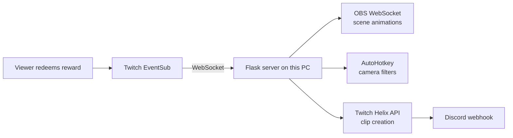

# 🎬 Production Center

**A live-stream control room that lets Twitch chat run the show.** Viewers spend channel points, and Production Center reacts in real time: it flips camera filters, rips animated Pokémon cards onto the screen, starts or stops automatic clipping that posts highlights straight to Discord, and can roll a downloaded Twitch clip with an orc voice line.

Widgets on this PC (the Fact Gnome, the translator, the orc, end credits) read one local feed from this server. The server connects out to Twitch EventSub over a WebSocket. Twitch does not call back into this PC.

> 📸 **Demo:** _GIF or screenshot coming soon_
> <!-- Drop a GIF of a redemption firing on stream here, e.g.  -->

---

## ✨ What it does

| Channel point reward | What happens on stream |
|---|---|
| **Add Camera Filter** | Applies a random camera filter (via AutoHotkey hotkeys), then clears it after 3 minutes. |
| **Rip a Vintage Pokémon Card** | Pulls a random Gen 1 card the viewer hasn't caught yet, slides it across the screen with an eased OBS animation, and shows their progress toward all 151. Each viewer's collection is saved. |
| **Start** / **Stop** | Starts or stops an auto-clipping loop that creates Twitch clips on a timer and posts each one to a Discord channel. |
| **Play a Clip** | Plays a random mp4 from the local clip library (top World of Warcraft clips plus a few of the most-viewed clips on Twitch, downloaded when the server starts) and a random file from `voice_lines/orc/`. The orc widget gets a `clip` event. If the library is empty, it falls back to a Twitch embed. The title match ignores case. Rename it with `CLIP_REWARD_TITLE` if you want. |
| **Translate to English** / **Translate from English** | Not handled inside the reward `if` chain. Every redemption is published on `/events` (including the viewer's text). The translator widget sees those and calls `/translate` and `/tts`. Create both rewards with "Require viewer to enter text" turned on. |

Follows, subs, resubs, gifted subs, and cheers are published on the same feed and collected for the end-credits roll.

## 🧠 Why it's interesting

Production Center ties **five separate systems** together into one real-time pipeline:



- **Event-driven:** This PC opens one WebSocket to Twitch. Events arrive the moment they happen. There is no polling for redemptions, and no public URL.
- **Non-blocking:** Each effect runs on its own thread or process, so a 3-minute filter never stalls the next redemption.
- **Process management:** The clipping loop runs as a supervised child process with safe start, stop, and force-kill handling.
- **Persistent game state:** Per-viewer Pokémon collections survive between streams.
- **One local feed:** Widgets poll `GET /events`. They do not hold Twitch tokens.

## 🛠️ Tech used

- **Python 3** with **Flask** (local server on `127.0.0.1:5000`)
- **Twitch EventSub WebSocket** via `websocket-client` (redemptions, follows, subs, cheers) and **Twitch Helix API** (subscriptions and clips)
- **OBS WebSocket v5** via `obsws-python` (scene item animation and text updates)
- **edge-tts** (free neural voices for widgets). ElevenLabs is optional.
- **yt-dlp** (downloads Twitch clips as mp4 files for Play a Clip)
- **AutoHotkey** (camera filter hotkeys)
- **Discord webhooks** (clip notifications)
- **Pillow** (`sheetripper.py` slices card sheets into individual card images)

## 📁 Project layout

```
Server.py              Flask server: EventSub WebSocket, feed, TTS, translate, credits
archive.py             Auto-clipping loop (Twitch Helix) + Discord posting
clips.py               App access token, Helix clip lookups, and the mp4 downloader
clips_cache/           Downloaded mp4 clips and index.json (gitignored; rebuilt on startup)
widgets/               HTML widgets served at /widgets/ (orc, monk, gnome, and the rest)
Pokemon/pokerip.py     Pokémon card pull logic + OBS animation
pokemon_catches.json   Saved per-viewer collections
credits.html           End-credits page for an OBS browser source
banned_words.txt       Optional whole-word filter (empty = off)
voice_lines/orc/       Drop recorded mp3/wav lines here
CameraFilters/         Random filter picker, clear script, AutoHotkey filter hotkeys
sheetripper.py         Utility: cut card sheets into single card images
unsubscribe.py         Utility: remove EventSub subscriptions (WebSocket or old webhook)
tests/                 Example pytest tests and a short guide
```

`tts_cache/`, `stream_credits.json`, and the files inside `clips_cache/` are created at runtime and gitignored. `stream_credits.json` holds viewer display names for the current roll. `clips_cache/index.json` is the list of mp4s the orc can play.

## 🔐 Twitch scopes and how subscribing works

On startup the server opens a WebSocket to `wss://eventsub.wss.twitch.tv/ws` (or `EVENTSUB_WS_URL`, if you set one). When Twitch sends `session_welcome`, `subscribe_to_events()` registers one subscription per event type on that session. It does not open a Twitch login window. It sends your existing user token to Helix:

```http
POST https://api.twitch.tv/helix/eventsub/subscriptions
Client-ID: <TWITCH_CLIENT_ID>
Authorization: Bearer <TWITCH_OAUTH_TOKEN>
```

The JSON body sets the transport to `websocket` and includes the `session_id` from the welcome message. There is no callback URL and no signing secret.

`TWITCH_OAUTH_TOKEN` must be a **user** access token for the broadcaster. An **app** access token will not work for these WebSocket subscriptions. Generate a new user token when you add scopes. With the [Twitch CLI](https://dev.twitch.tv/docs/cli/):

```bash
twitch token -u -s "channel:read:redemptions moderator:read:followers channel:read:subscriptions bits:read"
```

Put the access token in `TWITCH_OAUTH_TOKEN` and the app's client id in `TWITCH_CLIENT_ID`.

| Scope | Used for |
|---|---|
| `channel:read:redemptions` | Channel point redemptions (`channel.channel_points_custom_reward_redemption.add` v1) |
| `moderator:read:followers` | Follows (`channel.follow` v2) |
| `channel:read:subscriptions` | Subs, resubs, and gifted subs |
| `bits:read` | Cheers (`channel.cheer` v1) |

Follow v2 also sends `moderator_user_id`. This server sets that to `BROADCASTER_USER_ID`, so the token has to belong to the broadcaster (you are always a mod on your own channel).

Play a Clip does **not** use that user token. It uses an app token from `clips.py` (`client_credentials`), which needs `TWITCH_CLIENT_ID` plus `TWITCH_CLIENT_SECRET` (the client secret from the Twitch developer console). Reading clips does not add another scope on the user token.

### What you need to change

1. Copy any new keys from `.env.example` into `.env`. Names only live in the example file. Never commit `.env`.
2. Delete `WEBHOOK_URL` and `EVENTSUB_SECRET` from `.env`. The server does not read them anymore. You can uninstall ngrok.
3. Run `python unsubscribe.py` once. That deletes subscriptions left over from the old webhook, including any that still point at an old public address. WebSocket subscriptions also end when the server disconnects.
4. Set `TWITCH_CLIENT_SECRET` to the app client secret. `clips.py` reads that for Play a Clip. If you leave it blank, `clips.py` still falls back to `SECRET`. Keep `SECRET` when that fallback is the client secret you still use.
5. `TWITCH_OAUTH_TOKEN` must be a **user** token for your channel with all four scopes above. An app token will not create the WebSocket subscriptions. A token that only has `channel:read:redemptions` will keep redemptions working and Twitch will reject the other subscriptions (the server prints the error and keeps going).
6. Leave `EVENTSUB_WS_URL` blank for real Twitch. Set it only when you point the client at the Twitch CLI mock (see below).
7. Create the channel point rewards in the Creator Dashboard (table above). Titles for the old rewards must match exactly. **Play a Clip** ignores case.
8. Drop at least one `.mp3` or `.wav` in `voice_lines/orc/` if you want the orc to talk. With zero files the clip event is still published and `voice_line` is empty. The clip event also includes `reward` (the channel-point title) so a widget can filter on `?reward=`.
9. Widgets now live in the `widgets/` folder in this repo. Delete `WIDGETS_DIR` from `.env`, or leave it blank, to serve those. Keep the old line only if you still want the Desktop folder (`C:\Users\tyler\Desktop\Stream-Widgets`) instead.
10. Run `pip install -r requirements.txt` again so `yt-dlp` is installed. Play a Clip uses it to save mp4 files. Optional: `ELEVENLABS_API_KEY` and `ELEVENLABS_VOICE_ID` for `/tts?engine=eleven`. Optional: `DEEPL_API_KEY` as the last translation fallback. Optional: add lines to `banned_words.txt`.

`/translate` tries, in order: Google's free `translate.googleapis.com` `client=gtx` endpoint (no key), then [MyMemory](https://mymemory.translated.net/) (no key), then DeepL only if `DEEPL_API_KEY` is set. The Google endpoint is unofficial. It can change or rate-limit, which is why the fallbacks exist.

## 🚀 How to run it

### 1. Prerequisites
- Windows, Python 3.10+, [OBS Studio](https://obsproject.com/) with WebSocket server enabled, and [AutoHotkey](https://www.autohotkey.com/) v1
- A Twitch application ([dev.twitch.tv/console](https://dev.twitch.tv/console)) and the channel point rewards in the table above
- A user token with the four scopes in the section above

### 2. Install
```bash
python -m venv venv
venv\Scripts\activate
pip install -r requirements.txt
```

### 3. Configure your secrets
```bash
copy .env.example .env
```
Fill in `.env` with your own Twitch, Discord, and OBS values. **`.env` is git-ignored; never commit it.**

Names in `.env.example`:

| Name | Required? | What it is |
|---|---|---|
| `EVENTSUB_WS_URL` | No | WebSocket address. Blank means `wss://eventsub.wss.twitch.tv/ws`. |
| `TWITCH_CLIENT_SECRET` | For Play a Clip and `clips.py` | App client secret from the Twitch console. Falls back to `SECRET`. |
| `CLIP_REWARD_TITLE` | No | Reward title to listen for. Blank means `Play a Clip`. |
| `ELEVENLABS_API_KEY` / `ELEVENLABS_VOICE_ID` | No | Paid TTS. Blank uses edge-tts. |
| `DEEPL_API_KEY` | No | Last translation engine. Blank skips DeepL. |
| `WIDGETS_DIR` | No | Override for the widgets folder. Blank serves `widgets/` in this repo. Set it only to use a different folder. |
| `GEMINI_API_KEY` | For Benito and Ask the Monk | Same key Benito already uses. The monk returns a canned saying if it is blank. |
| `COUNSEL_MODEL` | No | Blank means `gemini-2.5-flash-lite`. |
| `COUNSEL_USER_COOLDOWN` | No | Seconds between Gemini answers for one viewer. Blank means 60. |
| `COUNSEL_DAILY_CAP` | No | Monk calls per local day. Blank means 100. |
| `GEMINI_PROJECT_DAILY_CAP` | No | Monk + Benito calls per local day. Blank means 900, so a busy night leaves room for Benito. |

### 4. Launch
```bash
python Server.py
```

The server listens on `127.0.0.1:5000` only. Point OBS and widgets at `http://localhost:5000` or `http://127.0.0.1:5000`. A request with `X-Forwarded-For` or `X-Forwarded-Host`, or from any other machine, gets 403.

You should see a welcome line with a session id, then one `subscribed` line per event type (or `Already subscribed` if that type was already active). Redeem a reward on your channel to test it.

If the socket drops, the client waits and tries again. The wait doubles each time and stops growing at 30 seconds. A fresh session creates the subscriptions again. If Twitch sends `session_reconnect`, the client connects to the new URL, keeps the subscriptions it already has, and closes the old socket only after the new welcome.

### 5. Optional: fire events with the Twitch CLI mock

Leave `EVENTSUB_WS_URL` blank for a real channel. To practice without redeeming, the [Twitch CLI](https://dev.twitch.tv/docs/cli/websocket-event-command) can pretend to be EventSub.

In one terminal:

```bash
twitch event websocket start-server
```

The mock prints `Connect to the WebSocket server at: ws://127.0.0.1:8080/ws`. Put that in `.env`:

```
EVENTSUB_WS_URL=ws://127.0.0.1:8080/ws
```

Start `python Server.py` and wait for the welcome line. In another terminal, with the server still running:

```bash
twitch event trigger channel.follow --transport=websocket
twitch event trigger channel.channel_points_custom_reward_redemption.add --transport=websocket
```

The trigger reaches every client connected to the mock. You can target one session with `--session=` and the id from the welcome line.

Subscription POSTs still go to real Twitch Helix. The mock's session id is not a real Twitch session, so those lines usually fail while you are on the mock. The trigger is still delivered. Clear `EVENTSUB_WS_URL` when you want real Twitch again. Real `subscribed` lines are the check that your user token and scopes are right.

### 6. End credits in OBS
1. In OBS, add a **Browser** source. Do not check "Local file".
2. URL: `http://localhost:5000/credits`
3. Width `1920`, height `1080`.
4. Check **Shutdown source when not visible** and **Refresh browser when scene becomes active** if you want a clean crawl each time you show it.
5. The page background is transparent. Leave custom CSS empty unless you want to restyle it.
6. The page polls `http://localhost:5000/credits.json` every few seconds and scrolls Subs, Gifted Subs, Bits, and Follows like movie credits.
7. At the start of the next stream, clear the roll from this PC:

```bash
curl -X POST http://127.0.0.1:5000/credits/reset
```

Someone who receives a gifted sub is listed under Subs. The person who sent the gifts is listed under Gifted Subs. Anonymous cheers and gifted subs have no Twitch username. They are stored as one **Anonymous** line per group, and the amounts add up, because the server cannot tell those viewers apart.

### 7. Word filter
`banned_words.txt` is a plain list, one word or phrase per line. Lines starting with `#` are comments. The file ships with no words, so nothing is filtered until you add one. Matching is case-insensitive and whole-word. Hits are replaced with stars in redemption text before it is published, and again on `/translate` and `/tts`. Usernames are not filtered. If the file is missing or unreadable, text is left alone.

### 8. Widgets in OBS
Twitch will not play a clip embed on a `file://` page. Add each widget as a **Browser** source (not a local file):

```
http://localhost:5000/widgets/<widget>/index.html
```

`<widget>` is the folder name inside `widgets/` (or inside `WIDGETS_DIR`, if you set one). The orc presenter is `orc-clip`:

```
http://localhost:5000/widgets/orc-clip/index.html?parent=localhost
```

Use `http://127.0.0.1:5000/...` if `localhost` misbehaves. The route only serves files inside that folder (`send_from_directory` blocks `..`). Responses send `Cache-Control: no-store`, so an OBS "Refresh cache of current page" picks up edits.

### 9. Play a Clip with sound
On startup the server starts a background download. It does not wait for the files before it opens port 5000. It deletes the old files in `clips_cache/`, asks Helix for clips, saves each one as an mp4 with yt-dlp, and writes `clips_cache/index.json`. Watch the log for a line like `downloaded 12 clips`. A clip that fails is skipped. The others are still saved.

The library is:

- the 10 most-viewed World of Warcraft clips from the last 24 hours
- the 5 most-viewed clips from the last 24 hours across the 50 games that currently have the most viewers

Helix cannot list "all of Twitch" in one call. Get Clips needs a channel, a game, or a clip id. The top-games list is the supported way to approximate a site-wide top 5. If the same clip shows up in both lists, it is downloaded once.

A **Play a Clip** redeem picks a random row from the index and publishes a `clip` event. `video_url` is `/clips/<file>.mp4`, and `broadcaster_name` is the channel the clip came from. The widget plays that file in a normal `<video>` tag, which is allowed to autoplay with sound inside OBS. The older embed fields are still on the event. If `clips_cache` is empty because the download has not finished, the server falls back to the old behavior: it asks Helix for the recent top WoW clips (the same 200 hour list `python clips.py` prints), picks one, and publishes the embed. That fallback includes `broadcaster_name` too. `video_url` is blank, so the widget uses the iframe.

`GET /clips/<file>` serves the mp4 from this PC only, same as the other routes.

Manual check, after `pip install -r requirements.txt`:

1. Start the server and wait for `downloaded N clips` in the log.
2. In OBS, add a Browser source. Leave **Local file** unchecked. URL:

```
http://localhost:5000/widgets/orc-clip/index.html?parent=localhost
```

3. In another terminal, start the Twitch CLI mock and point the server at it:

```
twitch event websocket start-server
```

```
EVENTSUB_WS_URL=ws://127.0.0.1:8080/ws
```

4. Restart the server so it connects to the mock, then trigger the reward:

```
twitch event trigger channel.channel_points_custom_reward_redemption.add --transport=websocket --item-name "Play a Clip"
```

5. The clip should play with sound, and the header should show the channel name (`CHANNEL: Title`).

`python clips.py` still prints a WoW clip list and does not download anything. That script keeps its older 200 hour window. The library the orc plays uses 24 hours.

### 10. Ask the Monk
Create a channel point reward named **Ask the Monk** with "Require viewer to enter text" on. The widget reads that redemption from `/events` and calls `GET /counsel`. The server uses the same `GEMINI_API_KEY` as Benito. It never sends the key to the widget. A blocked word, a viewer who just asked, a full daily cap, or any Gemini error returns one of 30 canned sayings (`"source": "canned"`) instead. Counts for the monk and Benito share `gemini_usage.json` (gitignored). The monk voice on `/tts` is `en-HK-SamNeural`.

```bash
curl "http://localhost:5000/counsel?q=tank%20or%20healer&user=test"
```

### 11. Fact Gnome pre-recorded voice

The Fact Gnome plays a Kokoro wav from `widgets/fact-gnome/voice/` when that fact is in `voice/voices.js`. If the line is missing, it falls back to live `/tts`, then the browser voice. `?prerec=0` skips the recordings. Those wavs and `voices.js` stay on this PC (they are gitignored). Kokoro is not part of the server install.

Use a separate Python 3.12 venv so Kokoro's torch stays out of the server environment. In PowerShell, from the project folder:

```powershell
py -3.12 -m venv .venv-voice
.\.venv-voice\Scripts\Activate.ps1
pip install -r requirements-voice.txt
python widgets\fact-gnome\tools\make_gnome_voices.py
```

The first run downloads the Kokoro model. `--voice` can be `af_bella` (the default), `af_heart`, or `bf_emma`. `--speed` defaults to `1.1`.

```powershell
python widgets\fact-gnome\tools\make_gnome_voices.py --voice af_heart --speed 1.1
```

In OBS, refresh the Fact Gnome browser source. Rerun the script whenever `widgets/fact-gnome/facts/facts.js` changes. Lines that already exist are skipped, and audio for a deleted fact is removed.

## 🧪 Tests

Example tests live in `tests/`. The guide in [`tests/README.md`](tests/README.md) explains what a unit test is, what a mock is, how to run them, and walks through one test line by line. `tests/test_clip_library.py` checks the mp4 library without calling Twitch or yt-dlp's downloader. The same guide has the manual OBS check for Play a Clip.

```bash
pip install -r requirements-dev.txt
pytest -v
```

---

Built by [Tyler Dodgen](https://github.com/dodgen92) to make streams more interactive.
