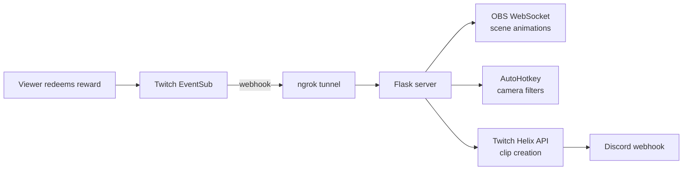

# 🎬 Production Center

**A live-stream control room that lets Twitch chat run the show.** Viewers spend channel points, and Production Center reacts in real time: it flips camera filters, rips animated Pokémon cards onto the screen, starts or stops automatic clipping that posts highlights straight to Discord, and can roll a random channel clip with an orc voice line.

Widgets on this PC (the Fact Gnome, the translator, the orc, end credits) read one local feed from this server. Twitch only talks to `POST /webhook`.

> 📸 **Demo:** _GIF or screenshot coming soon_
> <!-- Drop a GIF of a redemption firing on stream here, e.g.  -->

---

## ✨ What it does

| Channel point reward | What happens on stream |
|---|---|
| **Add Camera Filter** | Applies a random camera filter (via AutoHotkey hotkeys), then clears it after 3 minutes. |
| **Rip a Vintage Pokémon Card** | Pulls a random Gen 1 card the viewer hasn't caught yet, slides it across the screen with an eased OBS animation, and shows their progress toward all 151. Each viewer's collection is saved. |
| **Start** / **Stop** | Starts or stops an auto-clipping loop that creates Twitch clips on a timer and posts each one to a Discord channel. |
| **Play a Clip** | Picks a random clip from your channel and a random file from `voice_lines/orc/`, then publishes a `clip` event for the orc widget. The title match ignores case. Rename it with `CLIP_REWARD_TITLE` if you want. |
| **Translate to English** / **Translate from English** | Not handled inside the reward `if` chain. Every redemption is published on `/events` (including the viewer's text). The translator widget sees those and calls `/translate` and `/tts`. Create both rewards with "Require viewer to enter text" turned on. |

Follows, subs, resubs, gifted subs, and cheers are published on the same feed and collected for the end-credits roll.

## 🧠 Why it's interesting

Production Center ties **five separate systems** together into one real-time pipeline:



- **Event-driven:** Twitch pushes events to a Flask webhook the moment they happen; there's no polling for redemptions.
- **Non-blocking:** Each effect runs on its own thread or process, so a 3-minute filter never stalls the next redemption.
- **Process management:** The clipping loop runs as a supervised child process with safe start, stop, and force-kill handling.
- **Persistent game state:** Per-viewer Pokémon collections survive between streams.
- **One local feed:** Widgets poll `GET /events`. They do not hold Twitch tokens.

## 🛠️ Tech used

- **Python 3** with **Flask** (webhook server)
- **Twitch EventSub** (redemptions, follows, subs, cheers) and **Twitch Helix API** (clips)
- **OBS WebSocket v5** via `obsws-python` (scene item animation and text updates)
- **ngrok** (exposes only the webhook to Twitch over HTTPS)
- **edge-tts** (free neural voices for widgets). ElevenLabs is optional.
- **AutoHotkey** (camera filter hotkeys)
- **Discord webhooks** (clip notifications)
- **Pillow** (`sheetripper.py` slices card sheets into individual card images)

## 📁 Project layout

```
Server.py              Flask server: webhook, feed, TTS, translate, credits
archive.py             Auto-clipping loop (Twitch Helix) + Discord posting
clips.py               App access token + Helix clip lookups
Pokemon/pokerip.py     Pokémon card pull logic + OBS animation
pokemon_catches.json   Saved per-viewer collections
credits.html           End-credits page for an OBS browser source
banned_words.txt       Optional whole-word filter (empty = off)
voice_lines/orc/       Drop recorded mp3/wav lines here
                           Widgets stay in WIDGETS_DIR (not in this repo)
CameraFilters/         Random filter picker, clear script, AutoHotkey filter hotkeys
sheetripper.py         Utility: cut card sheets into single card images
unsubscribe.py         Utility: remove old EventSub subscriptions
tests/                 Example pytest tests and a short guide
tests.txt              More tests to write yourself
```

`tts_cache/` and `stream_credits.json` are created at runtime and gitignored. `stream_credits.json` holds viewer display names for the current roll.

## 🔐 Twitch scopes and how subscribing works

On startup, `subscribe_to_events()` in `Server.py` registers one webhook subscription per event type. It does not open a Twitch login window. It sends your existing user token to Helix:

```http
POST https://api.twitch.tv/helix/eventsub/subscriptions
Client-ID: <TWITCH_CLIENT_ID>
Authorization: Bearer <TWITCH_OAUTH_TOKEN>
```

The JSON body uses `WEBHOOK_URL` as the callback and `EVENTSUB_SECRET` (or `SECRET`, if that is all you have) as the signing secret. Twitch then signs every `POST /webhook` with that secret. The server checks the signature before it does anything else.

`TWITCH_OAUTH_TOKEN` must be a **user** access token for the broadcaster, not an app token. Generate a new one when you add scopes. With the [Twitch CLI](https://dev.twitch.tv/docs/cli/):

```bash
twitch token -u -s "channel:read:redemptions moderator:read:followers channel:read:subscriptions bits:read"
```

Put the access token in `TWITCH_OAUTH_TOKEN` and the app's client id in `TWITCH_CLIENT_ID`.

| Scope | Used for |
|---|---|
| `channel:read:redemptions` | Channel point redemptions (`channel.channel_points_custom_reward_redemption.add` v1) |
| `moderator:read:followers` | Follows (`channel.follow` v2) |
| `channel:read:subscriptions` | Subs, resubs, and gifted subs |
| `bits:read` | Cheers (`channel.cheer` v1) |

Follow v2 also sends `moderator_user_id`. This server sets that to `BROADCASTER_USER_ID`, so the token has to belong to the broadcaster (you are always a mod on your own channel).

Play a Clip does **not** use that user token. It uses an app token from `clips.py` (`client_credentials`), which needs `TWITCH_CLIENT_ID` plus `TWITCH_CLIENT_SECRET` (the client secret from the Twitch developer console). Reading clips does not add another scope on the user token.

### What you need to change

1. Copy any new keys from `.env.example` into `.env`. Names only live in the example file. Never commit `.env`.
2. Set `EVENTSUB_SECRET` to the webhook secret (10–100 characters). If you leave it blank, the server keeps using `SECRET`, which is what it sent to Twitch before.
3. Set `TWITCH_CLIENT_SECRET` to the app client secret. `clips.py` used to read `SECRET` for this. If `SECRET` was your made-up webhook secret and not the client secret, WoW clip lookup and Play a Clip need the real client secret now. If you leave `TWITCH_CLIENT_SECRET` blank, `clips.py` still falls back to `SECRET`.
4. Replace `TWITCH_OAUTH_TOKEN` with a token that has all four scopes above. A token that only has `channel:read:redemptions` will keep redemptions working and Twitch will reject the new subscriptions (the server prints the error and keeps going).
5. If you change `EVENTSUB_SECRET` or `WEBHOOK_URL`, run `python unsubscribe.py` and start the server again so Twitch stores the new callback and secret. A plain restart is fine when those values did not change: an already-active subscription prints `Already subscribed` (HTTP 409) and the new types are created.
6. Create the channel point rewards in the Creator Dashboard (table above). Titles for the old rewards must match exactly. **Play a Clip** ignores case.
7. Drop at least one `.mp3` or `.wav` in `voice_lines/orc/` if you want the orc to talk. With zero files the clip event is still published and `voice_line` is empty. The clip event also includes `reward` (the channel-point title) so a widget can filter on `?reward=`.
8. Set `WIDGETS_DIR` to your Stream-Widgets folder. On this PC that is `C:\Users\tyler\Desktop\Stream-Widgets`. The server does not bake that path in. If the variable is blank or the folder is not there, `/widgets/...` returns 404 and prints why.
9. Optional: `ELEVENLABS_API_KEY` and `ELEVENLABS_VOICE_ID` for `/tts?engine=eleven`. Optional: `DEEPL_API_KEY` as the last translation fallback. Optional: add lines to `banned_words.txt`.

`/translate` tries, in order: Google's free `translate.googleapis.com` `client=gtx` endpoint (no key), then [MyMemory](https://mymemory.translated.net/) (no key), then DeepL only if `DEEPL_API_KEY` is set. The Google endpoint is unofficial. It can change or rate-limit, which is why the fallbacks exist.

## 🚀 How to run it

### 1. Prerequisites
- Windows, Python 3.10+, [OBS Studio](https://obsproject.com/) with WebSocket server enabled, [AutoHotkey](https://www.autohotkey.com/) v1, and [ngrok](https://ngrok.com/)
- A Twitch application ([dev.twitch.tv/console](https://dev.twitch.tv/console)) and the channel point rewards in the table above
- A user token with the four scopes in the section above

### 2. Install
```bash
python -m venv venv
venv\Scripts\activate
pip install -r requirements.txt
```

### 3. Configure your secrets
```bash
copy .env.example .env
```
Fill in `.env` with your own Twitch, Discord, and OBS values. **`.env` is git-ignored; never commit it.**

New names you will see in `.env.example`:

| Name | Required? | What it is |
|---|---|---|
| `EVENTSUB_SECRET` | Recommended | Webhook HMAC secret. Falls back to `SECRET`. |
| `TWITCH_CLIENT_SECRET` | For Play a Clip and `clips.py` | App client secret from the Twitch console. Falls back to `SECRET`. |
| `CLIP_REWARD_TITLE` | No | Reward title to listen for. Blank means `Play a Clip`. |
| `ELEVENLABS_API_KEY` / `ELEVENLABS_VOICE_ID` | No | Paid TTS. Blank uses edge-tts. |
| `DEEPL_API_KEY` | No | Last translation engine. Blank skips DeepL. |
| `WIDGETS_DIR` | For HTML widgets | Full path to the widgets folder. On this PC that is `C:\Users\tyler\Desktop\Stream-Widgets`. Blank means `/widgets/...` returns 404. |

### 4. Start ngrok and update the endpoint ⚠️
Twitch has to reach your PC over the internet, so ngrok gives your local server a public HTTPS address.

```bash
ngrok http 5000
```

ngrok prints a **Forwarding** address like `https://abc123.ngrok-free.app`. Put it in `.env` with `/webhook` on the end:

```
WEBHOOK_URL=https://abc123.ngrok-free.app/webhook
```

ngrok forwards the **whole** port. This server only accepts `POST /webhook` from that tunnel. `GET /events`, `/tts`, `/translate`, `/credits`, `/voice_lines/...`, and `/widgets/...` return 403 if the request carries `X-Forwarded-For` or `X-Forwarded-Host`, or if it did not come from this machine. Point OBS and widgets at `http://localhost:5000` or `http://127.0.0.1:5000`, not the ngrok URL.

> **Important:** Unless you have a reserved ngrok domain, this address **changes every time ngrok restarts**. Each time it does:
> 1. Update `WEBHOOK_URL` in `.env`.
> 2. Run `python unsubscribe.py` to clear the old subscription that points to the dead address.
> 3. Restart the server (next step), which subscribes again with the new address.

### 5. Launch
```bash
python Server.py
```
You should see a success line for each subscription (or `Already subscribed` if it was already active). Redeem a reward on your channel to test it.

### 6. End credits in OBS
1. In OBS, add a **Browser** source. Do not check "Local file".
2. URL: `http://localhost:5000/credits`
3. Width `1920`, height `1080`.
4. Check **Shutdown source when not visible** and **Refresh browser when scene becomes active** if you want a clean crawl each time you show it.
5. The page background is transparent. Leave custom CSS empty unless you want to restyle it.
6. The page polls `http://localhost:5000/credits.json` every few seconds and scrolls Subs, Gifted Subs, Bits, and Follows like movie credits.
7. At the start of the next stream, clear the roll from this PC (not through ngrok):

```bash
curl -X POST http://127.0.0.1:5000/credits/reset
```

Someone who receives a gifted sub is listed under Subs. The person who sent the gifts is listed under Gifted Subs. Anonymous cheers and gifted subs have no Twitch username. They are stored as one **Anonymous** line per group, and the amounts add up, because the server cannot tell those viewers apart.

### 7. Word filter
`banned_words.txt` is a plain list, one word or phrase per line. Lines starting with `#` are comments. The file ships with no words, so nothing is filtered until you add one. Matching is case-insensitive and whole-word. Hits are replaced with stars in redemption text before it is published, and again on `/translate` and `/tts`. Usernames are not filtered. If the file is missing or unreadable, text is left alone.

### 8. Widgets in OBS
Twitch will not play a clip embed on a `file://` page. Add each widget as a **Browser** source (not a local file):

```
http://localhost:5000/widgets/<widget>/index.html
```

`<widget>` is the folder name inside `WIDGETS_DIR`. Example, if the orc presenter lives in a folder named `orc-clip`:

```
http://localhost:5000/widgets/orc-clip/index.html
```

Use `http://127.0.0.1:5000/...` if `localhost` misbehaves. Do not use the ngrok URL. The route only serves files inside `WIDGETS_DIR` (`send_from_directory` blocks `..`). Responses send `Cache-Control: no-store`, so an OBS "Refresh cache of current page" picks up edits.

## 🧪 Tests

Example tests live in `tests/`. The guide in [`tests/README.md`](tests/README.md) explains what a unit test is, what a mock is, how to run them, and walks through one test line by line. [`tests.txt`](tests.txt) is the list to write next.

```bash
pip install -r requirements-dev.txt
pytest -v
```

---

Built by [Tyler Dodgen](https://github.com/dodgen92) to make streams more interactive.
