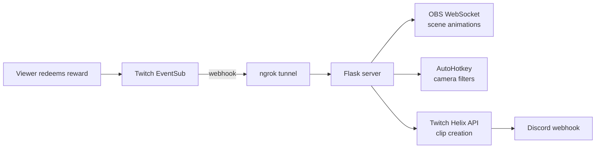

# 🎬 Production Center

**A live-stream control room that lets Twitch chat run the show.** Viewers spend channel points, and Production Center reacts in real time: it flips camera filters, rips animated Pokémon cards onto the screen, and starts or stops automatic clipping that posts highlights straight to Discord.

> 📸 **Demo:** _GIF or screenshot coming soon_
> <!-- Drop a GIF of a redemption firing on stream here, e.g.  -->

---

## ✨ What it does

| Channel point reward | What happens on stream |
|---|---|
| **Add Camera Filter** | Applies a random camera filter (via AutoHotkey hotkeys), then clears it after 3 minutes. |
| **Rip a Vintage Pokémon Card** | Pulls a random Gen 1 card the viewer hasn't caught yet, slides it across the screen with an eased OBS animation, and shows their progress toward all 151. Each viewer's collection is saved. |
| **Start** / **Stop** | Starts or stops an auto-clipping loop that creates Twitch clips on a timer and posts each one to a Discord channel. |

## 🧠 Why it's interesting

Production Center ties **five separate systems** together into one real-time pipeline:



- **Event-driven:** Twitch pushes redemptions to a Flask webhook the moment they happen; there's no polling.
- **Non-blocking:** Each effect runs on its own thread or process, so a 3-minute filter never stalls the next redemption.
- **Process management:** The clipping loop runs as a supervised child process with safe start, stop, and force-kill handling.
- **Persistent game state:** Per-viewer Pokémon collections survive between streams.

## 🛠️ Tech used

- **Python 3** with **Flask** (webhook server)
- **Twitch EventSub** (channel point redemptions) and **Twitch Helix API** (clips)
- **OBS WebSocket v5** via `obsws-python` (scene item animation and text updates)
- **ngrok** (exposes the local server to Twitch over HTTPS)
- **AutoHotkey** (camera filter hotkeys)
- **Discord webhooks** (clip notifications)
- **Pillow** (`sheetripper.py` slices card sheets into individual card images)

## 📁 Project layout

```
Server.py              Flask webhook server; routes each reward to its effect
archive.py             Auto-clipping loop (Twitch Helix) + Discord posting
Pokemon/pokerip.py     Pokémon card pull logic + OBS animation
pokemon_catches.json   Saved per-viewer collections
CameraFilters/         Random filter picker, clear script, AutoHotkey filter hotkeys
sheetripper.py         Utility: cut card sheets into single card images
unsubscribe.py         Utility: remove old EventSub subscriptions
clips.py               Utility: list top recent WoW clips on Twitch
```

## 🚀 How to run it

### 1. Prerequisites
- Windows, Python 3.10+, [OBS Studio](https://obsproject.com/) with WebSocket server enabled, [AutoHotkey](https://www.autohotkey.com/) v1, and [ngrok](https://ngrok.com/)
- A Twitch application ([dev.twitch.tv/console](https://dev.twitch.tv/console)) and channel point rewards named exactly as in the table above

### 2. Install
```bash
python -m venv venv
venv\Scripts\activate
pip install -r requirements.txt
```

### 3. Configure your secrets
```bash
copy .env.example .env
```
Fill in `.env` with your own Twitch, Discord, and OBS values. **`.env` is git-ignored; never commit it.**

### 4. Start ngrok and update the endpoint ⚠️
Twitch has to reach your PC over the internet, so ngrok gives your local server a public HTTPS address.

```bash
ngrok http 5000
```

ngrok prints a **Forwarding** address like `https://abc123.ngrok-free.app`. Put it in `.env` with `/webhook` on the end:

```
WEBHOOK_URL=https://abc123.ngrok-free.app/webhook
```

> **Important:** Unless you have a reserved ngrok domain, this address **changes every time ngrok restarts**. Each time it does:
> 1. Update `WEBHOOK_URL` in `.env`.
> 2. Run `python unsubscribe.py` to clear the old subscription that points to the dead address.
> 3. Restart the server (next step), which subscribes again with the new address.

### 5. Launch
```bash
python Server.py
```
You should see `✅ EventSub subscription successful!`. Redeem a reward on your channel to test it.

---

Built by [Tyler Dodgen](https://github.com/dodgen92) to make streams more interactive.